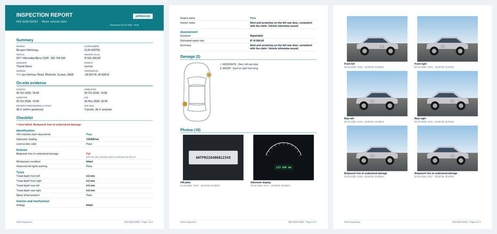
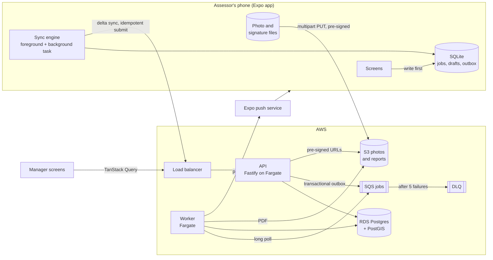
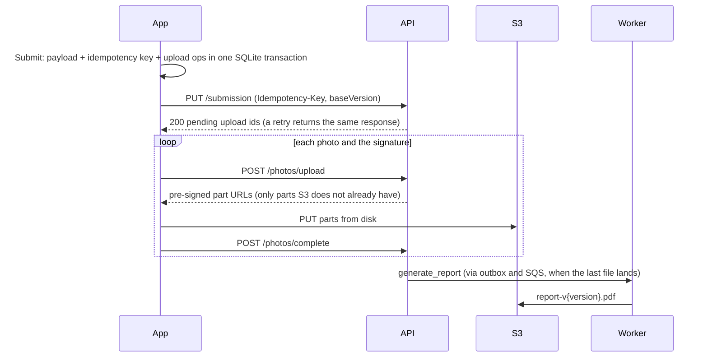
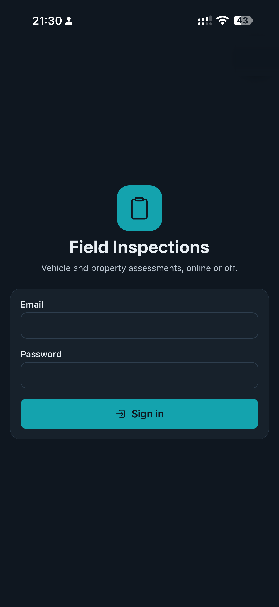
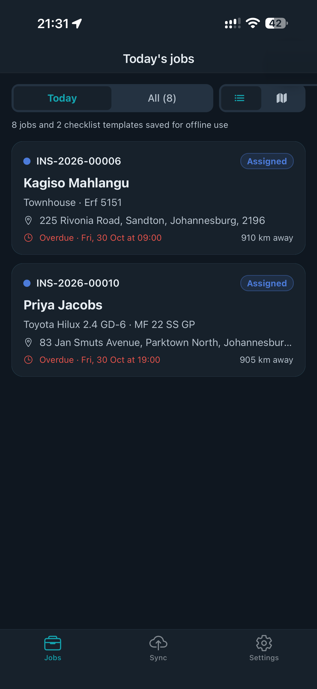
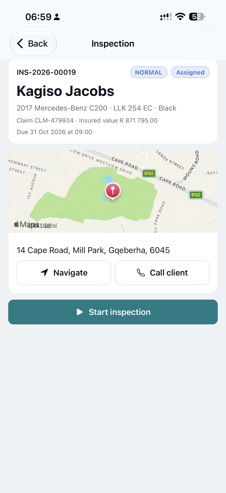
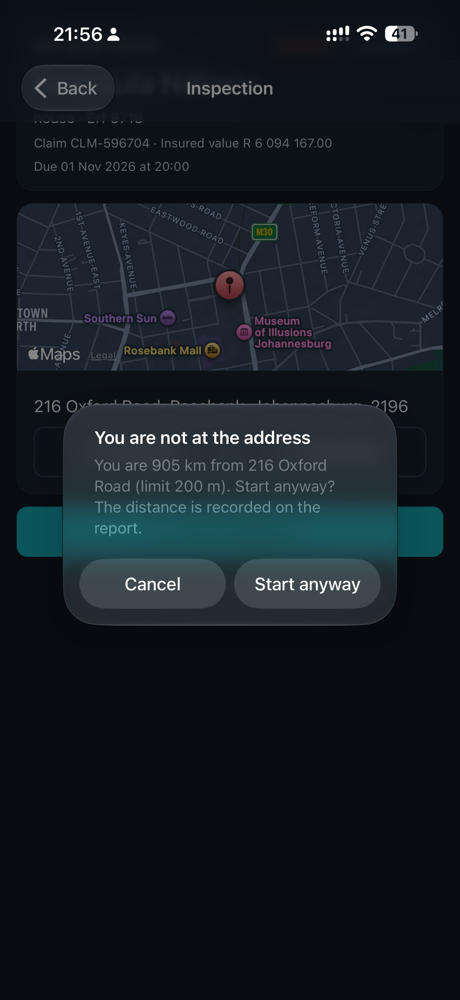
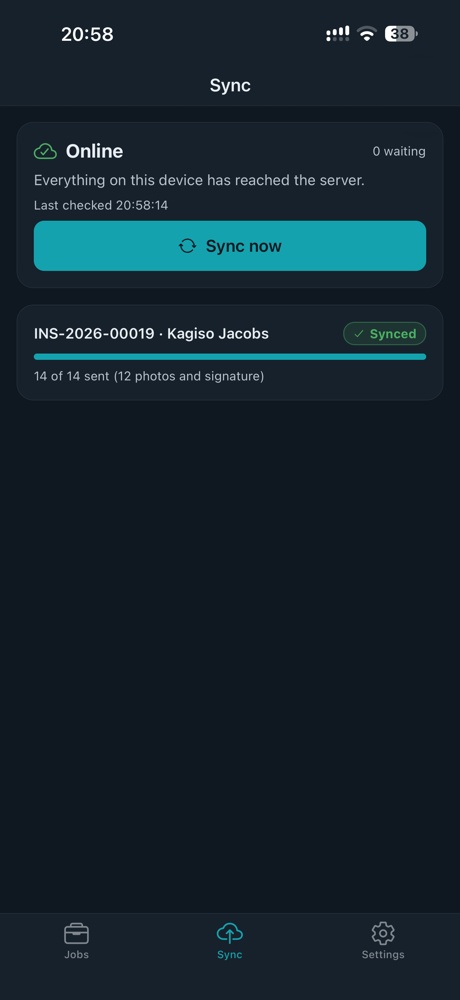
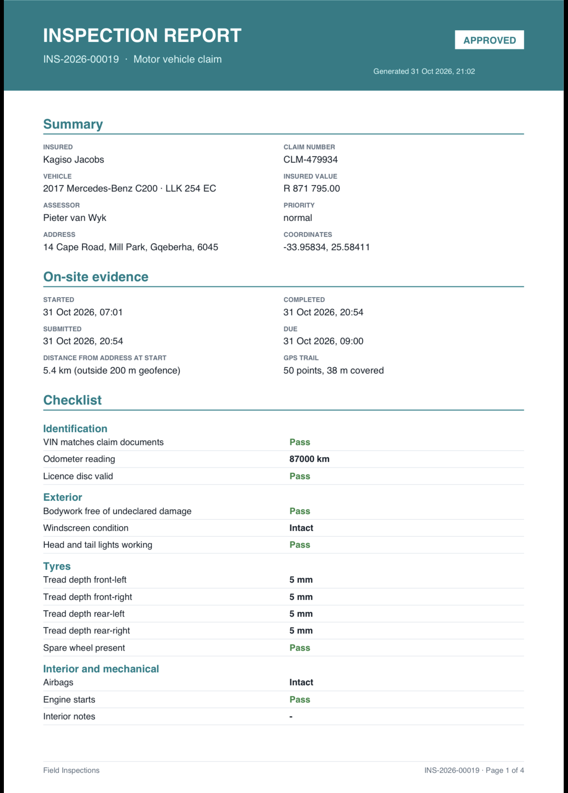

# Field Inspections

[](https://github.com/tashen247/field-inspections-mobile/actions/workflows/ci.yml)


An offline-first mobile app for field assessors who inspect vehicles and properties for
insurance claims and underwriting. Assessors download their jobs, work through a guided
checklist with GPS-stamped photos, damage markup and a client signature, all without signal,
and the app syncs reliably when they are back online. Managers assign jobs, review submissions
and download a generated PDF report.

- **Mobile:** React Native (Expo SDK 58, Expo Router), TypeScript strict, SQLite + Drizzle,
  TanStack Query, Zustand, React Hook Form + Zod, Reanimated, Gesture Handler, Skia, react-native-maps
- **Backend:** Node 22, Fastify 5, Zod schemas shared with the app, Drizzle on PostgreSQL + PostGIS
- **Jobs:** SQS + DLQ, a worker that renders PDF reports (pdf-lib) and sends Expo push notifications
- **Infra:** AWS CDK: ECS Fargate (API and worker), RDS Postgres, S3, SQS. GitHub Actions CI.



<sub>Pages from [`docs/sample-report.pdf`](docs/sample-report.pdf), produced by the worker from a
real end-to-end run (`pnpm --filter @fim/api demo:flow`).</sub>

## Contents

- [What it does](#what-it-does)
- [Architecture](#architecture)
- [Run it locally](#run-it-locally)
- [Design decisions](#design-decisions)
- [API](#api)
- [Testing and CI](#testing-and-ci)
- [Deploying to AWS](#deploying-to-aws)
- [Project layout](#project-layout)

## What it does

**Field assessor**

- Email and password sign-in with rotating refresh tokens in SecureStore, and optional Face ID /
  fingerprint quick unlock.
- Today's jobs as a list or a map, with distance from where you are, due time and priority.
  "Navigate" hands off to Apple Maps or Google Maps.
- Jobs, checklist templates and example framing images are cached for offline use.
- Starting a job checks a 200 m geofence and records the start time and position.
- Checklists are rendered from versioned templates: pass / fail / N/A, numeric readings with
  ranges (odometer, tread depth), dropdowns and notes. Required items and photos block submit.
- Guided camera shots ("Front-left", "VIN plate", "Roof"), resized to 1600 px, watermarked with
  time and GPS, and compressed under 500 KB on the device.
- Damage pins with severity on a vehicle or floor-plan diagram; tap to add, drag to move.
- Client signature on a Skia canvas.
- Submit queues everything locally. Background sync sends the data, then the photos as
  resumable uploads. Killing the app mid-upload loses nothing and duplicates nothing.
- A sync screen shows what is pending, retrying or failed, with retry.
- If a manager changed or reassigned a job while you were offline, a conflict screen explains
  what changed and lets you choose, instead of overwriting anything.
- Push notifications when a job is assigned or sent back. Swipe a job to start it or submit it.
  Dark mode, haptics, accessible labels, and loading, empty and error states throughout.

**Inspection manager** (same app, role-gated)

- All inspections filtered by status: Assigned, In progress, Submitted, Approved, Sent back.
- Assign or reassign to an assessor.
- Review the checklist, photo gallery, damage pins, signature and GPS trail on a map; approve or
  send back with a comment. Every change is in the audit trail.
- Download the generated PDF report.

## Architecture



A submission, end to end:



## Run it locally

Requirements: Node 22, pnpm 10 (`corepack enable`), Docker, and an Android emulator or iOS
simulator (or a phone) with a [development build](https://docs.expo.dev/develop/development-builds/introduction/).

```bash
cp .env.example .env
pnpm install
docker compose up -d          # Postgres + PostGIS and LocalStack (S3, SQS)
pnpm dev                      # API on :3000, worker, and the Expo dev server
```

On first start the API applies migrations and loads demo data. Press `a` (Android) or `i`
(iOS) in the Expo terminal; the first time, build the dev client with
`pnpm --filter @fim/mobile exec expo run:android` (or `run:ios`). The app needs a development
build rather than Expo Go because it uses background tasks and native modules.

Demo logins (password `Inspect!2026` for all):

| Role     | Email                           | Has jobs in                  |
| -------- | ------------------------------- | ---------------------------- |
| Assessor | `thandi.nkosi@demo.fim.co.za`   | Johannesburg                 |
| Assessor | `pieter.vanwyk@demo.fim.co.za`  | Gqeberha                     |
| Manager  | `ayesha.moodley@demo.fim.co.za` | Durban jobs start unassigned |

Seed data uses real South African streets with coordinates (Sandton, Rosebank, Walmer,
Summerstrand, Umhlanga, Berea and more), local vehicles (Hilux, Polo Vivo, Ranger) and rand values.
`pnpm db:seed --reset` restores it; `--count 5000 --mixed` loads a large mixed-status set.

**On a physical phone**, set `EXPO_PUBLIC_API_URL=http://<your-LAN-IP>:3000` and
`S3_PUBLIC_ENDPOINT_URL=http://<your-LAN-IP>:4566` in `.env`, so the phone can reach the API and
the pre-signed upload URLs.

**Without a phone**, `pnpm --filter @fim/api demo:flow` (with `pnpm dev:backend` running) drives
the whole definition-of-done flow over HTTP: the manager assigns a job, the assessor starts it
inside the geofence, submits 10 photos, two damage pins and a signature, retries the submission
to prove it is idempotent, uploads the files, the manager approves, and the worker's PDF is saved
to `docs/sample-report.pdf`.

API docs (OpenAPI, generated from the shared Zod schemas) are at <http://localhost:3000/docs>.

### Screenshots

Running on an iPhone against the local stack:

| Sign in                                                                 | Today's jobs, saved for offline use                                                               | Job detail                                                                                                          |
| ----------------------------------------------------------------------- | ------------------------------------------------------------------------------------------------- | ------------------------------------------------------------------------------------------------------------------- |
|  |  |  |

| Geofence check on start                                                                                                  | Sync status after submitting                                                                              | Generated PDF report                                                                                  |
| ------------------------------------------------------------------------------------------------------------------------ | --------------------------------------------------------------------------------------------------------- | ----------------------------------------------------------------------------------------------------- |
|  |  |  |

The Maestro flow in [`apps/mobile/.maestro`](apps/mobile/.maestro/offline-inspection.yaml)
captures the rest of the journey (map, checklist, damage markup, signature and the sync screen
in airplane mode) into `docs/screenshots/`:

```bash
maestro test apps/mobile/.maestro/offline-inspection.yaml
```

## Design decisions

Each has a short ADR in [`docs/decisions`](docs/decisions/README.md).

- **Offline store.** SQLite is the source of truth on the device; every action is written there
  before anything touches the network, and screens re-render from database change events.
  ([0002](docs/decisions/0002-sqlite-as-the-source-of-truth-on-device.md))
- **Sync queue.** A durable outbox, processed in order per inspection with exponential backoff.
  Ops left in flight by a killed app are retried on the next start.
  ([0003](docs/decisions/0003-durable-outbox-for-sync.md))
- **Idempotency and conflicts.** Submissions carry an idempotency key generated once and reused
  on every retry, and a `baseVersion`; the server replays duplicates and returns 409 with the
  current job when a manager changed it.
  ([0004](docs/decisions/0004-idempotent-submission-and-optimistic-versioning.md))
- **Resumable uploads.** Photos go from disk straight to S3 as multipart uploads; asking again
  for an upload slot returns only the parts S3 does not yet have.
  ([0005](docs/decisions/0005-resumable-multipart-uploads.md))
- **Delta sync.** Keyset cursors over `(updated_at, id)` with a small overlap window; p95 well
  under the 200 ms target for 5,000 inspections (roughly 15 to 40 ms in local runs). ([0006](docs/decisions/0006-delta-sync-with-keyset-cursors.md))
- **PDF worker.** Jobs are written to a Postgres outbox in the same transaction as the change,
  relayed to SQS, and handled idempotently by the worker; the correlation id follows the request
  from API to worker logs. ([0007](docs/decisions/0007-transactional-outbox-and-pdf-worker.md))
- **Photo pipeline.** Resize, watermark and compress on the device with Skia.
  ([0008](docs/decisions/0008-photo-processing-on-device.md))

## API

All routes are under `/v1` except `/health` and `/docs`.

| Method | Path                                                 | Who      | Purpose                                                               |
| ------ | ---------------------------------------------------- | -------- | --------------------------------------------------------------------- |
| POST   | `/auth/login`, `/auth/refresh`                       | anyone   | JWT access token + rotating refresh token                             |
| GET    | `/inspections?assignedTo=me&since=&cursor=`          | both     | Delta sync / list (assessors only see their own)                      |
| GET    | `/inspections/:id`                                   | both     | Full detail: answers, photos, pins, signature, GPS trail, audit trail |
| GET    | `/templates`                                         | both     | Versioned checklist templates                                         |
| POST   | `/inspections/:id/start`                             | assessor | Start, with geofence distance                                         |
| PUT    | `/inspections/:id/submission`                        | assessor | Submit (requires `Idempotency-Key`, `baseVersion`)                    |
| POST   | `/inspections/:id/photos/upload`, `/photos/complete` | assessor | Resumable multipart uploads                                           |
| POST   | `/inspections`                                       | manager  | Create a job                                                          |
| PATCH  | `/inspections/:id`, `/inspections/:id/assign`        | manager  | Edit, assign or reassign                                              |
| PATCH  | `/inspections/:id/review`                            | manager  | Approve, or send back with a comment                                  |
| GET    | `/inspections/:id/report`                            | both     | Pre-signed link to the PDF                                            |
| GET    | `/users?role=assessor`                               | manager  | Assessors for the assign picker                                       |
| POST   | `/devices`                                           | both     | Register an Expo push token                                           |
| GET    | `/reference-images/:name.svg`                        | anyone   | Example framing for guided shots                                      |

Errors share one shape: `{ code, message, correlationId, details? }`. Every response carries an
`x-correlation-id` header, which also appears in API and worker logs (pino).

## Testing and CI

```bash
pnpm lint && pnpm typecheck && pnpm test:coverage
pnpm --filter @fim/api bench:sync     # delta sync latency against 5,000 inspections
pnpm synth                            # cdk synth
```

- **API** (Vitest, against Postgres/PostGIS and LocalStack): auth and token rotation, role checks,
  delta sync paging and reassignment, idempotent and concurrent submission, version conflicts,
  checklist validation, resumable uploads against S3, review and audit trail, outbox relay to SQS.
- **Worker** (Vitest): PDF generation from stored photos and signature, idempotent re-runs, push
  delivery and dead-token cleanup, SQS consumer retry behaviour.
- **Shared**: checklist validation rules and formatting.
- **Mobile** (Jest + React Native Testing Library): checklist renderer, required-field
  validation, the sync queue against a real SQLite file (including an app restart mid-upload
  that resumes without re-sending parts or duplicating the submission), and the conflict screen.
- **Infra**: CDK assertions on the synthesised stack.

Coverage is above 90% on `apps/api`, `apps/worker` and `packages/shared` (CI enforces 70%).
GitHub Actions runs lint, typecheck, tests with service containers, the latency benchmark and
`cdk synth` on every push and pull request. An optional manual workflow builds an Android
preview with EAS.

## Deploying to AWS

```bash
cd infra
npx cdk bootstrap      # once per account/region
npx cdk deploy -c env=dev
```

The stack (default region `af-south-1`, Cape Town) creates a VPC, RDS Postgres 16 (PostGIS is
enabled by the first migration), a private S3 bucket with CORS for direct uploads, SQS with a DLQ
and alarm, and API and worker services on Fargate (ARM64) with secrets from Secrets Manager.
`-c env=prod` turns on deletion protection and retains data on teardown.

## Project layout

```
apps/
  mobile/     Expo app (src/app routes, src/db SQLite, src/sync engine, src/features)
  api/        Fastify API (routes, services, seed, demo flow, latency benchmark)
  worker/     SQS consumer: PDF reports and push notifications
packages/
  shared/     Zod schemas, types, checklist validation, templates
  db/         Drizzle schema and Postgres migrations
infra/        AWS CDK stack
docs/         ADRs, sample PDF report, screenshots
```

## License

[MIT](LICENSE)
